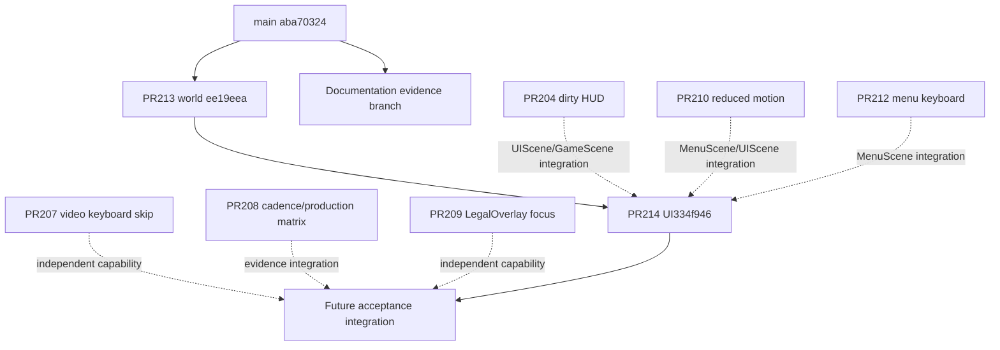

# OFELIYA — Frontend overhaul progress

**Mutation-art follow-up published:** product7a0d829 (dependent PR216) restores packaged mutation textures after Boot fallback while preserving first-render startup and existing Player references. All exact-head CI jobs and the12-case matrix passed; Render Free deploy dep-db8sqinf3r2c73f9u5f0 is live at10:08:41 Moscow. Public hash/health/state checks retain74scores and4profiles unchanged. [Paired frames, independent reviews and release evidence](docs/frontend-overhaul/release/mutation-art/RECOVERY.md). Device/FPS/newcomer gates and distinct mutation-palette work remain open.

Updated 16 October 2026 (Europe/Moscow). **Phase0 has a verified inventory and baseline; Phase1 has implemented candidate PRs. Neither the entire master task nor all physical-device acceptance gates are complete.**

Continuation recovered the interrupted release work. Final candidate is `44c657935f3124724fe6a3191d1b29c35189e4f2`; its only test delta from `d5cae44` waits for the real boss presentation before checking contextual host hints. No production source changed during continuation. The full six-viewport comprehension smoke passed twice, and an isolated no-wait run reproduced the original stale-hint CI failure. All fifteen earlier reviewed file digests remain identical; the refreshed review manifest includes the changed sixteenth test file. Fresh presentation contracts and TypeScript passed. Exact-head CI and live release results are recorded in the release section below; older candidate/pending statements further down preserve the previous snapshot.

**Published and verified:** all exact-head CI jobs and the twelve-case visual matrix passed. Render deployment `dep-db8ko259fdbs739ncmsg` became live on 16 October at00:57:09 Moscow, exact candidate44c6579. Public marker/assets/readiness/persistence and preservation of74 scores/4 profiles were verified. Public desktop Chrome confirms menu startup at320/360/390 and mutation choice, live field and joystick/onboarding progression at390; no page/console/CSP/HTTP errors. Five optional art requests were cancelled and their three resources independently returned200. [Final release evidence, browser captures and limits](docs/frontend-overhaul/release/RELEASE_20261016.md). Main and service settings remain unchanged; PRs remain open. Physical-device/newcomer/later-phase gates remain open.

The candidate replaces broad bright bloodstream lanes with a quieter vascular field, gives antibody/host interiors structure, and applies a coherent specimen presentation to menu, HUD, mutation, boss reveal and results. Narrow menu/result layout and primary-action readability were corrected. These are reviewable code changes and production-build captures, not only recommendations.

## Exact state and permissions

| Item | Verified snapshot / scope |
|---|---|
|Starting main|`aba70324d13592fbcd86894fb29f395ac201f48a`; initial clean checkout|
|Public marker at Phase0 readback|`30a534fbf1656979c20434d4f4d724eea69c385f`; does not establish candidate publication|
|World PR|[#213](https://github.com/timoshinoleg-eng/ofeliya/pull/213), head `ee19eea`, base main|
|UI PR|[#214](https://github.com/timoshinoleg-eng/ofeliya/pull/214), head `44c657935f3124724fe6a3191d1b29c35189e4f2`, base PR213 world branch|
|Documentation|This branch `docs/frontend-overhaul-20261015`; no product source copied here|
|Merge|**Not authorized.** Do not merge either candidate or existing open work into main|
|Deployment|Owner separately authorized deployment after validation. Permission is not evidence that deployment is done; exact-SHA CI and live readback remain separate gates|

SHAs/CI/PR states are snapshots. Refresh GitHub and production before integration/release. This report intentionally preserves the starting marker rather than substituting the candidate SHA without a live readback.

## Phase0 — completed evidence and remaining work

- [x] Read canonical repository instructions, product/architecture/release/provenance documents and prior handoff/state.
- [x] Query current main, existing open PRs and returned head checks; retain raw sanitized snapshots in [audit](docs/frontend-overhaul/audit/PHASE0_SOURCE_AUDIT.md).
- [x] Identify stale prior handoff status and unavailable14October handoff; do not invent its contents.
- [x] Inspect current typography, art, pools, FX and production HiDPI boundary.
- [x] Capture baseline production QA states at320×568,360×640,390×740: menu, gameplay,100/150/200 display density, lowHP+host, boss, mutation, result.27 baseline PNGs, zero page errors in capture report.
- [x] Probe requested model routes; publish actual failures and continue with available Codex agents.
- [x] Produce prioritized top20 source/historical leads with anchors, effort and risk; then address selected verified visual problems.
- [ ] Full live game walkthrough through campaign, all rich result branches, keyboard/focus states and all exceptional network states.
- [x] Independent blind still comparison and final-fix recheck; independent exact-head code review.
- [ ] Physical-device readability, performance/thermal and newcomer acceptance.

The synthetic capture fixture freezes rendering and constructs display states. It is suitable for deterministic visual comparison, **not** measured live combat,100/150/200-AI simulation or device FPS evidence. Baseline390 height is740px in this run, rather than the844px suggested by the inventory; additional tall-device coverage remains useful.

## Phase1 — delivered candidate

| Slice | Files / behavior | Rationale and protection |
|---|---|---|
|World|`src/game/StrainZeroTextures.ts`|Boot-baked256×256 vascular tile replaces wide sine lanes; quiet tissue volumes repeat toroidally. Antibody receptor and host nuclear/organellar interiors use source-atop after packaged/fallback art. Dimensions/exterior alpha/logical scales remain bounded; no RNG/game-loop change|
|Shared visual grammar|`src/ui/visualTokens.ts`, `src/ui/specimenSurface.ts`|Ink/matte/ivory with restrained player rose, host celadon, immune cyan, warning amber. Static Graphics membrane seams and perimeter organelles; no listeners/RNG/timers/per-frame creation|
|Menu|`src/scenes/MenuScene.ts`|Quiet title and surfaces, separated compact records, clearer primary action. Difficulty decoration redraws active accent/profile fill to preserve state cues|
|HUD|`src/scenes/UIScene.ts`|More opaque ink plate, retained membrane, clear player XP and host health. Existing geometry/type floors/hit areas remain; PR204 optimization not duplicated|
|Mutation/boss|`src/scenes/UIScene.ts`|Rounded membrane cards, visible family rail, measured copy zones, reduced title/ring glare. Boss portrait uses ordinary blending; existing pointer transaction and modal callbacks preserved|
|Result|`src/scenes/UIScene.ts`, `src/ui/tokens.ts`|Opaque report scrim; title wrapping and measured title→time spacing; grouped two-line statistics; explicitly opaque primary-action recipe0.95. Original Rectangle owns hit area; no decorative underlay|
|Contract updates|`tests/core-art.mjs`, `tests/atmosphere-presentation.mjs`, `tests/tokens-contract.mjs`|New palette injected into source fixture, broad-lane assertion replaced by executed deterministic wrapped-tile checks, intended primary-fill contract updated; geometry/RNG/pool protections retained|
|Design package|[Art Bible](docs/frontend-overhaul/design/ART_BIBLE.md), [three directions / nine editable concept frames](docs/frontend-overhaul/design/concepts.html)|Original vector concepts menu/field/mutation. Clearly labeled concepts, not screenshots; chosen Vascular Archive contrasted with Glass Cytology and Living Tissue|

No balance, RNG stream, checkpoint migration, anti-cheat, networking/server or score-version change is part of these slices. Existing audio/art provenance remains intact. New diagrams use original SVG shapes and existing OFL font bytes.

## Validation ledger

| Evidence | Actual recorded result | Limit |
|---|---|---|
|TypeScript|`npx tsc --noEmit` passed during slice and final shared-recipe work|Not runtime acceptance|
|UI/data contracts|tokens, UI copy, mutation copy, viewport, RNG/checkpoint/save/duel reported passed locally for candidate|Root records final exact-head/full CI separately|
|Presentation|Full `test:presentation` exit0: core-art16/16; VFX12; atmosphere9/9; audio20/20; biological deterministic pixels/12 frames/fallback;23 pinned audio assets|No performance/visual quality guarantee|
|Production QA capture|27before +27after PNGs,3 widths, no page errors; [after summary](docs/frontend-overhaul/media/after/summary.json)|Frozen synthetic display-state fixture; not live gameplay|
|Capture cadence|120samples per width, p50≈16.7ms/p95≈16.8–16.9ms, zero longRatio in fixture|Explicitly **not** real-device/combat FPS benchmark|
|Source review|Independent review found and resolved P2 difficulty decoration masking active state; no remaining P0/P1/P2 established in reviewed diff|Reviewed file digests bind snapshot; later changes need affected-file review; visual review separate|
|SVG package|9inline SVGs parse, no remote assets/scripts/canvas/filters; self-contained HTML|Browser artwork composition review still belongs to coordinator|
|Whitespace|`git diff --check` passed in product slice|Documentation branch check recorded before commit|

Full exact-head hosted CI, final independent visual judgment and final live-browser walkthrough are pending until evidence is appended. Do not infer CI success from local tests or presence of a PR. Root is still updating final captures/tests; refresh copied media after any regeneration.

## Existing work and dependency graph

Initial queried open heads:204 `41cd0101`;207 `d9d7f5ef`;208 `0e606ca3`;209 `6adab4bf`;210 `aae35c9c`;212 `729e5a48`. Their returned head checks were SUCCESS at audit time. They remain separate from this candidate; green individual branches do not establish combined compatibility.204↔210 overlap GameScene/UIScene;210↔212 overlap MenuScene;207/208/209/210/212 share CI/package files. PR185 is merged baseline work, not a task to recreate. Review integration deliberately; do not cherry-pick all branches blindly.

## Top20 disposition after implementation

The complete original anchor/effort/risk table is preserved in [PHASE0_SOURCE_AUDIT.md](docs/frontend-overhaul/audit/PHASE0_SOURCE_AUDIT.md). It identifies candidates rather than claiming every source pattern is a defect.

|#|Lead|Current disposition|
|---|---|---|
|1|Fragmented type hierarchy|Partially addressed menu/HUD/card/result; no full social/global typography migration|
|2|Inconsistent surfaces/radii|Shared membrane primitive adopted in selected screens; SocialHub remains outside slice|
|3|Display/body metrics mismatch|Existing fonts preserved; glyph/device readability still requires measurement|
|4|Menu secondary density|Compact separation improved; combined resume/challenge/keyboard states need full walkthrough|
|5|Subtitle hierarchy|Menu hierarchy reworked; concept is not proof of device readability|
|6|Muted utility contrast|Selected menu palette improved; all states/social coverage remains open|
|7|Fragmented primary action|Explicit0.95 recipe and UI state use implemented; remaining controls not globally migrated|
|8|Transparent HUD plate|Ink plate opacity increased and membrane retained; dense motion acceptance open|
|9|Small HUD labels|Color/hierarchy changed; geometry/type floors protected|
|10|Compact HUD pressure|No geometry rewrite; actual extreme values still require final browser/device checks|
|11|Mutation hierarchy|Implemented quiet module surfaces and clearer family/title/effect separation|
|12|Legendary spacing|Existing flow preserved; long trophy/campaign branch coverage remains open|
|13|Result density|Title/time/stat layout improved; extreme records/evolutions/async statuses remain gate|
|14|Heavy title shadows|Reduced across selected menu/mutation/result/boss treatments|
|15|Social microcopy|Deferred; no claim SocialHub polished by this patch|
|16|Dense outline convergence|World/interior treatment helps background separation; enemy family silhouettes not fully redesigned|
|17|Boss reveal competition|Quiet band/copy, normal portrait blend, HUD cinematic handling retained|
|18|Missing role animation cycles|Deferred; existing player/antibody atlas preserved|
|19|Reward/projectile visual kit|Deferred; concept shape grammar provided, no new production atlas claimed|
|20|HiDPI framebuffer softness|Deferred; production density gate preserved, not globally enabled|

## Previous audits: classification

- `VISUAL_POLISH_AUDIT_V3.md`: historical screenshots/CI; selected density/HUD/reveal leads rechecked against new captures, original score is not current acceptance.
- `DESIGN_20261007.md` / `VO_TRACEABILITY_20261008.md`: retained design/traceability constraints; implementation status must be read against new source.
- `CONTINUATION_ACCEPTANCE_20261008.md`: genuine older browser evidence with incomplete creative/HiDPI/device coverage; no inherited phone PASS.
- `HIDPI_FEASIBILITY_20261008.md`: QA prototype remains gated; current production2× not claimed.
- Earlier Kimi/final code reviews: frozen-diff source evidence; text-only/failed model routes are not image reviews.
- `2026-10-15-review-followups.md` and old memory top sections: startup/persistence work superseded by current main where applicable; do not duplicate or overwrite server fixes.
- Requested14October frontend handoff: not found in inspected paths. Absence recorded, contents not reconstructed.

## Route evidence and coordination

[Sanitized route report](docs/frontend-overhaul/routes/README.md): OmniRoute20128 and Agent Gateway20129 unavailable/no listener; OpenCode1.18.34 present but space-bunny-free rejected even isolated retry, big-pickle timed out55s without text, mimo returned server error; configured Kimi free fallback returned429. No route completed `ROUTE_OK`. Therefore **Kimi/OpenCode did not participate in implementation/review**. Available Codex agents handled source inventory, UI, procedural world art and independent source review. Only minimal probes, no paid fallback, credential printing or service reconfiguration.

## Remaining gates and next action

1. Refresh candidate heads/CI; await full exact-SHA required checks and rerun affected checks after fixes.
2. Finish independent blind before/after visual comparison and full production-build browser walkthrough; resolve concrete issues.
3. Bind final source-review evidence and captures to final hashes, refresh this package; keep documentation branch code-free.
4. For authorized deployment, use exact tested pushed candidate SHA on existing service, preserve data/backup, confirm live SHA/public marker/API/assets/browser and state continuity. Neither permission nor queued build means success.
5. Keep physical-device MAX/TG/iOS, S20+, performance/thermals, live density and newcomer gates explicitly open until measured. Continue later phases as their own slices; no automatic main merge.

## Final candidate evidence update

Final source head `d5cae44ac969b88607179d2693100380226a53b3`. The final commit centralizes the already-rendered0.8 HUD opacity and strictly updates its old0.45–0.5 fixture; all other A1–A12 checks unchanged. The effective visual values match capture/performance head `b739945`. Local six-viewport HUD hierarchy passed after this intended contract update.

[Side-by-side actual screenshots](docs/frontend-overhaul/COMPARISON.html), [rendered contact sheet](docs/frontend-overhaul/COMPARISON.png), [concept board](docs/frontend-overhaul/design/CONCEPTS.png), [80-second real touch recording](docs/frontend-overhaul/walkthrough/vertical-slice.mp4), [paired rendering cadence](docs/frontend-overhaul/PERFORMANCE.md), [independent code review](docs/frontend-overhaul/review/CODE_REVIEW.md), [blind still review and fix verification](docs/frontend-overhaul/review/BLIND_VISUAL_REVIEW.md).

Blind labels were X=candidate/Y=main. X preferred menu/gameplay/result/boss; initial mutation preference Y exposed perimeter interference. Followup confirms readable regeneration unit and no training overlap during boss still. Actual reveal methods now compensate4x backings, retain fitted cinematic zoom, and suppress hint visibility across overlapping reveals without changing tutorial counters/game clocks. Secondary microcopy remains small and is a Phase3/device followup.

Recording:390×740 Canvas, actual desktop touch emulation, muted audio, API fixtures and deliberately failed video downloads; real CTA, movement, three mutation choices, defeat/restart and another choice, zero page errors. VP8 source converted to H.264 MP4; original recording preserved. This is not a physical-phone/newcomer test or full campaign walkthrough.

Paired12-cell production-QA matrices reused PR208 scripts outside product code; both full matrix runs passed and cross-build sprite/role/quality poses match exactly. Software SwiftShader saturation makes these slow absolute intervals; first-pass tail/median variation is retained with selected repeat and limits. No60FPS/mobile/regression-free promise. QA JS416.57→420.66kB,gzip122.43→123.93kB; vendor/dependencies unchanged.

CI failure history retained:334f946 failed stale subtitle-text selector (replaced by stable named object with same15px floor); b739945 failed old HUD-opacity recipe (new strict0.8 expectation). Final exact-head CI and deploy readback are appended after verification; previous green visual matrices do not override failed old CI.

Supplementary main browser evidence downloaded from [CI38640569729](https://github.com/timoshinoleg-eng/ofeliya/actions/runs/38640569729), artifact11930283219/max-browser-smoke: challenge/resume menus/results, pause,Hud/boss,stage transitions,Heart/CARDIAC,legendary,Codex,renderer/DPR and density. These are hosted dev/browser fixtures on exact main, explicitly distinct from local production-QA before frames.
