# Completed Vascular Archive implementation

Product `abdb10c19d17de074f2be90e52d59cd9485c5b1b` ([PR217](https://github.com/timoshinoleg-eng/ofeliya/pull/217)) is published on the existing Render Free service, deployment `dep-db91jcff3r2c73fpgvs0`. Exact-head [CI38899978641](https://github.com/timoshinoleg-eng/ofeliya/actions/runs/38899978641) and [visual matrix38899973748](https://github.com/timoshinoleg-eng/ofeliya/actions/runs/38899973748) passed. Public release/HTML/runtime/service-worker hashes agree; main JS loads, readiness and remote persistence are healthy. State revision 170→171; 74 scores, 4 profiles and 1 registration remain, with all baseline scores and keys retained. Existing profile values changed: 0; registration values changed: 0. Main remains aba70324 and service settings are unchanged; PRs remain open. See [verified publication](PUBLICATION.md).

## Mutation composition

Both sides use the same real Player constructor and frozen time0pose at320×568, with attached Graphics first positioned by the real preUpdate. Existing packaged RGBA pixels are unchanged; authored geometry, value, blend and layering differ. Before runs original7a0d829 Player through a test-only Vite transform; after runs current Player. These are controlled presentation fixtures, not gameplay.

| State | Before | After |
|---|---|---|
| Prism |  | 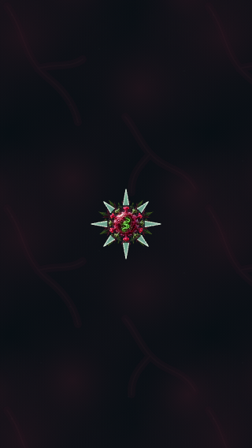 |
| Halo | 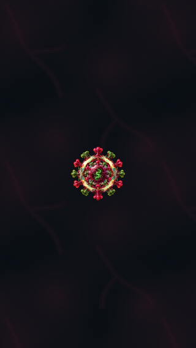 | 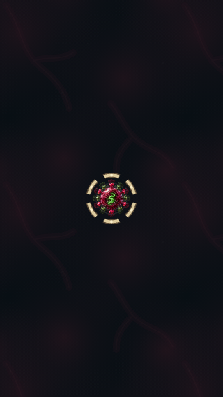 |
| Singularity | 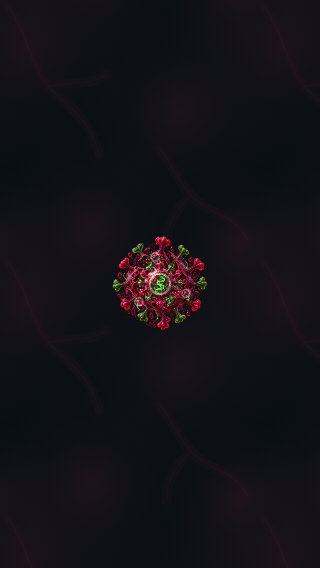 | 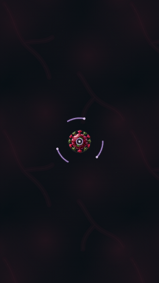 |
| Combined | 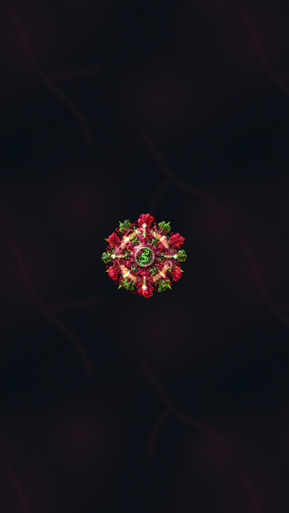 | 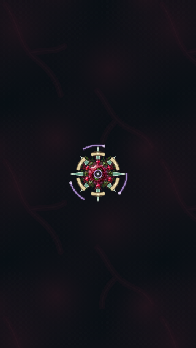 |

Matching Canvas captures and packaged recovery checks are alongside each set. Historic recovery captures that froze before attached Graphics placement are not used as composition comparison.

## Readable compact screens

The same expanded result fixture at320×568, before and after. The baseline failed the11px metadata floor; the finished report preserves readable text and exposes remaining details by scrolling.

| Before | After |
|---|---|
| 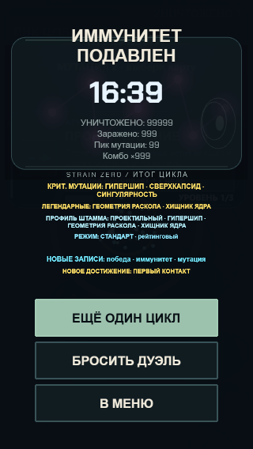 | 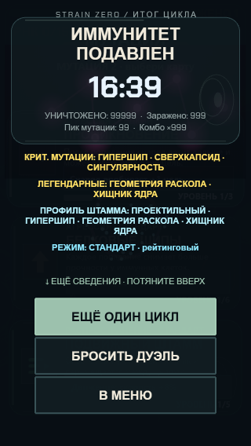 |

| Rich result | Scrolled report | SocialHub | Codex |
|---|---|---|---|
|  | 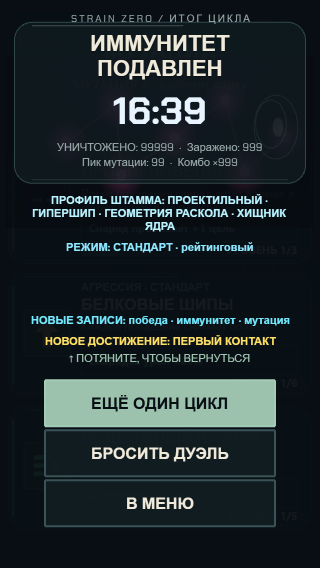 | 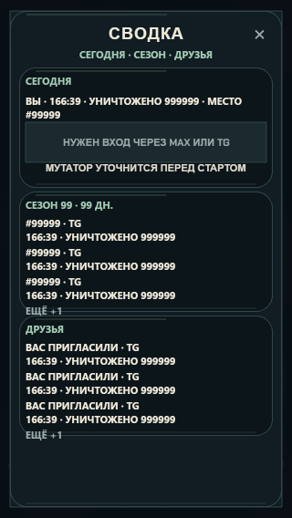 | 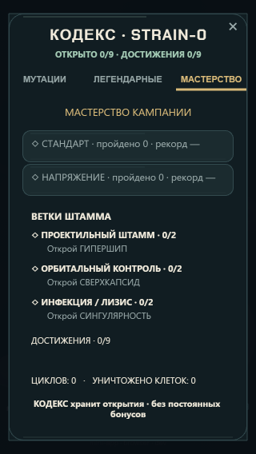 |

The screen folder includes320/360/390 widths, resumed/Strained result, social network errors and all three Codex pages. Browser assertions verify actual wrapped row bounds, metadata floor, action fit and no accidental activation when a drag ends on retry.

## Live simulation evidence

[Before Canvas](motion-before/canvas-live.webm), [after Canvas](motion-after/canvas-live.webm), [before WebGL](motion-before/webgl-live.webm), [after WebGL](motion-after/webgl-live.webm). Cadence JSON is alongside each clip. AI, physics, game update and actor animation run; playerHP is elevated and level choices are suppressed only in this test fixture. The100-spawn workload evolves, so these are not identical combat pixels or equal surviving-enemy counts. Both renderers have short-runp95~16.8ms before/after. This is desktop rAF cadence, not GPU/device FPS or sustained thermal performance.

## Independent review

Source audit identified mutation composition, social consistency and result metadata/flow gaps. Followup source review found scroll-release→CTA ownershipP2 and it was fixed/tested. Native review of rich/scrolled result, SocialHub/error, Codex and before/after live frames found no remaining P1/P2. New silhouettes separate player from the orange immune cluster more clearly in the inspected frames. Minor hidden-count footer spacing is not a blocker. Full subjective review of every video frame and physical-device/newcomer acceptance are not inferred.
