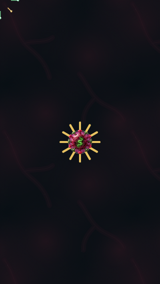
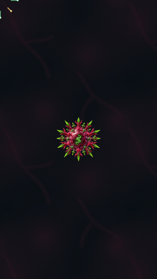
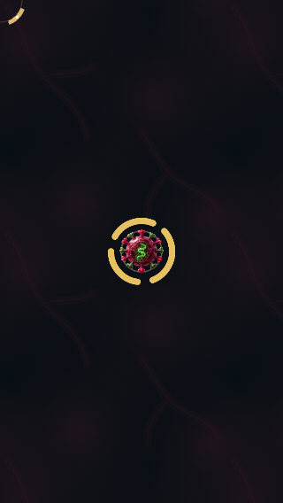
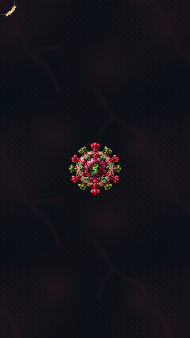
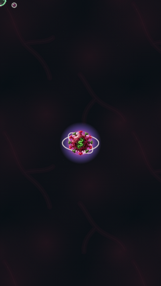
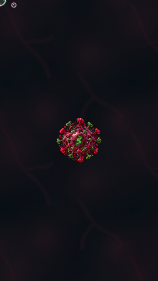
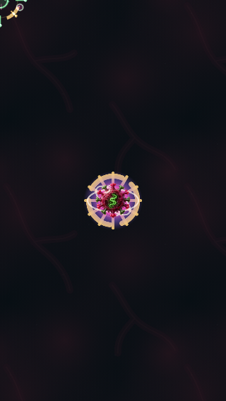
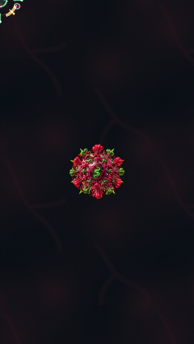

# Mutation art: delayed-file recovery

Real Phaser Player, frozen animation,320×568. Each pair is fallback then recovered packaged art. Both captures use the same Player and canonical256px textures. This is presentation evidence, not gameplay or device performance acceptance.

| State | Before (WebGL) | After (WebGL) |
|---|---|---|
| Prism |  |  |
| Halo |  |  |
| Singularity |  |  |
| Combined |  |  |

Canvas pairs are stored alongside these with the canvas- prefix. See [pixel/identity checks](recovery.json) and [release results](RECOVERY.md).
