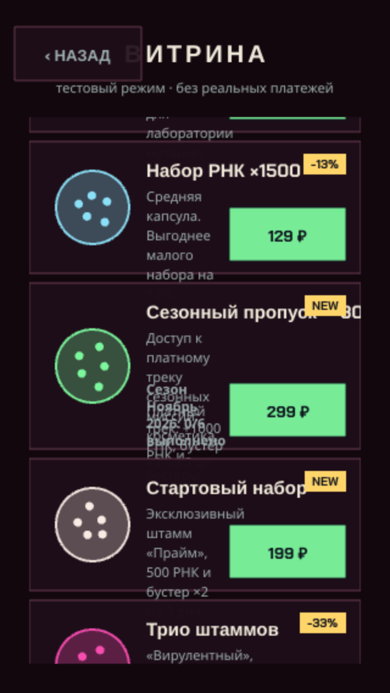
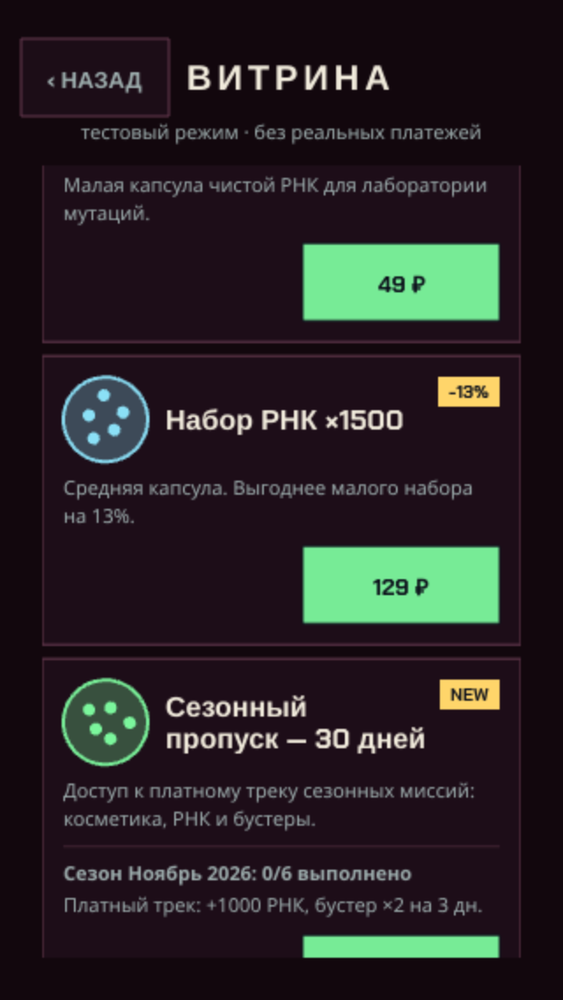

# PR #291 — исправление P1 и повторный adversarial-аудит монетизации v3

**PR:** https://github.com/timoshinoleg-eng/ofeliya/pull/291
**Ветка:** `feat/monetization-v3`
**База:** `fea41376b4d5143b12f8445e6f816df0f08967bf` (HEAD на момент первого ревью)
**Дата:** 2026-11-17
**Исходное ревью:** `ofeliya-pr291-deep-review-2026-11-17.md` (Muse, 2026-11-17)
**Метод:** три параллельные ветки исправлений (воркер / клиент / витрина) →
интеграция → второй независимый adversarial-аудит на интегрированном HEAD →
раунд 2 (новые P2) → замечания CodeRabbit review 5941028711 → финальная
верификация координатором. Каждое исправление — с RED-тестом на старом коде
и GREEN после. Пуш — через REST API (`gh-update-branch.py`), история
линеаризована ребейзом (мерджи были чистыми, дерево после ребейза
побайтово совпало с деревом до него).

## 1. Исходные P1: статус

| # | Дефект | Статус | Причина | Файлы | Коммиты |
|---|---|---|---|---|---|
| P1-1 | Возврат nonce_reuse-платежа невозможен (`handleAdminRefund` ищет только `payments`) | ✅ Исправлен | Возврат дубликатов — через тот же `refund_ops` state machine; новый статус `duplicate_payments.status` (`pending`→`refund_requested`→`refunded`); без reversal исходной покупки | `worker/src/index.ts`, `worker/src/sql.ts`, `worker/schema.sql`, `worker/migration-17.sql`, `tests/worker-p1-worker.mjs` | `beceb7c` (+ тесты `173adaa`, `200cb35`) |
| P1-2 | Сервер разрешает параллельные подписки | ✅ Исправлен | Три слоя: invoice 409 `subscription-active`/`subscription-pending`, pre-checkout `ok:false`, отклонение в webhook (заказ `denied`, без гранта) + guard-триггер против конкурентной двойной подписки (см. N1) | `worker/src/index.ts`, `worker/src/sql.ts`, `worker/schema.sql`, `worker/migration-17.sql` | `5b45dbb`, `af02740` |
| P1-3 | Потеря триггера = тихая потеря всех грантов | ✅ Исправлен (код + процедура) | `check-schema.mjs` — гейт схемы на изолированных in-memory БД (сверка текста триггера, колонки, UNIQUE, индексы, функциональный тест); read-back кошелька после грант-батча; runbook-гейт + процедура частичной миграции | `worker/scripts/check-schema.mjs`, `worker/scripts/check-schema.test.mjs`, `worker/scripts/v16-schema.fixture.sql`, `worker/src/index.ts`, `worker/README_DEPLOY.md`, `worker/migration-17.sql` | `91369ff`, `150605c`, `3314d4b` |
| P1-4 | Карточка пропуска нечитаема на 320 и 390 | ✅ Исправлен | Полная переработка витрины: измеренные высоты карточек, описание на всю ширину, статус за разделителем, шапка от измеренной подписи, resize-рестарт; Playwright-тест геометрии (18 кейсов) | `src/scenes/StorefrontScene.ts`, `scripts/storefront-layout-smoke.cjs`, `scripts/storefront-capture.cjs` | `bcc1709`, `4063b58`, `fc33e70`, `1b322ba` |
| P1-5 | Возврат пропуска не отзывает его локально (`max(local, server)`) | ✅ Исправлен | Синк серверно-авторитетен: reversal пропуска в батче → `local := server`; защита от устаревших ответов (курсор не отматывается); fail-open при сетевой ошибке | `src/game/shop/ServerWalletSync.ts`, `tests/server-wallet-sync.mjs` | `65213cb` |

Дополнительно из первого аудита исправлены: P2-1 (fail-closed при дубле
компонентов бандла, `8ebca80`), P2-2 (флаг + `cancelSubscription:true`,
`eca4730`), P2-3 (аудит админ-действий `source='admin'`, `eca4730`), P2-5
(идемпотентный ретрай инвойса, `a449d94`), P2-6 (pre-checkout try/catch +
таймаут 8с, `175cf59`), P2-7 (дедуп `app_open`, `460a3e6`), P2-8 (тег −13% →
−5% в Stars, `fa9d729`).

## 2. Новые находки

### P0 — кнопки покупки витрины были ПОЛНОСТЬЮ МЕРТВЫ (найдено исполнителем P1-4, ПОДТВЕРЖДЕНО вторым аудитом живым воспроизведением)

- **Суть:** scroll-catcher лежал ПОВЕРХ списка, а Phaser `topOnly=true` по
  умолчанию отдаёт тап только верхнему объекту. Тап по видимой кнопке не
  начинал покупку (`state: ready`, `lastBought: null` — зонд на `fea4137`,
  390×844). Дополнительно: в `root` копилось ДВА catcher-прямоугольника
  (утечка ре-рендера), а невидимые (замаскированные) кнопки были
  кликабельны — тап в шапку покупал невидимый товар (`lastBought:
  skin.gilded-prime`), т.к. маска режет только отрисовку, а не хит-тест.
- **Масштаб:** тот же catcher есть в `main 2bd6320`. С каталогом из 6
  товаров кнопки были мертвы только на коротких экранах (`scrollLimit>0`);
  v3 (9 товаров + карточка пропуска) сделала это универсальным. Задел ли
  это реальных пользователей — зависит от `VITE_PAYMENTS_API_URL` на Render
  (Этап 0 не выполнен, env, скорее всего, не настроен — тогда магазин был
  скрыт и P0 никого не задел; проверить можно только в дашборде Render).
- **Исправление:** catcher под списком, wheel — на уровне сцены; инпут
  кнопок гасится, когда их центр вне контентной области; утечка
  hit-rectangle закрыта (`4063b58`). Подтверждено зондами на новом коде:
  видимый тап → покупка, замаскированная кнопка → ничего.

### Новые P2 второго аудита (все исправлены в раунде 2)

| # | Находка | Исправление | Коммит |
|---|---|---|---|
| N1 | Конкурентная двойная подписка: проверка `season_pass_until_ms` и грант-батч в вебхуке — отдельные вызовы D1; интерливинг даёт `pass=now+60d` | Guard-триггер `RAISE(ABORT)` для не-продлённых `season_pass`-грантов при активном пропуске (продление — по derived nonce `:`; порядок батча UPDATE orders → INSERT payments → INSERT ledger делает JOIN по payments валидным; дубликатная доставка освобождена через NOT EXISTS). Проверено эмпирически, а не рассуждением | `af02740` |
| N2 | Отклонённый платёж: `/api/verify` возвращает `pending` навсегда, клиент врёт «выдадим автоматически», отклонённая подписка продлевается ежемесячно | Verify возвращает `denied`/`duplicate`; клиент снимает pending и показывает «платёж отклонён, возврат оформляется, поддержка /paysupport»; best-effort авто-отмена подписки при отклонении (идемпотентна, провал — только лог + reconcile). Новое событие `purchase_denied` (43 события в sync) | `4acb449` |
| N3 | Возврат бустера не отзывает его локально (близнец P1-5) | Неттинг по событию: `local := max(server, local + amount)` — вычитается ровно возвращённая длительность, миссионный бустер сохраняется. Наивное зеркало P1-5 (`local := server`) было бы неверно: у бустера есть локальные источники | `212bd69` |
| N4 | Прерванный скролл ПОКУПАЕТ: у кнопок нет порога движения, drag 12px с кнопки — покупка | Порог тапа 10px между `pointerdown`/`pointerup`; покрыто Playwright-зондами (drag 12px → нет покупки, drag 70px → скролл, тап → покупка) | `cefebc2` |

### Новые P3 второго аудита

- **N2 (P3):** `check-schema` не проверял `v17` в `schema_migrations` —
  исправлено (`8600767`).
- **N3 (P3):** `storefront-layout-smoke` без per-case catch: один флейк
  убивал все кейсы — исправлено (`9f0cf40`, + ожидание `window.__game`).
- **N7 (P3):** 409 `subscription-active`/`pending` доходили как generic
  `invoice-create-failed` — исправлено (`eb0f0d4`).
- **P3-10 (вырос из P3):** `/api/wallet` молча обрезал ledger на LIMIT 5000 —
  fresh sync мог пропустить недавний reversal и «воскресить» пропуск —
  исправлено пагинацией (`truncated:true`, `since_seq`, курсор = max
  возвращённого id) (`d98587f`).
- **Не исправлены (наблюдения, не блокеры):** N1-read-back слеп к повторной
  покупке уже имеющегося скина; P3-N4 (воркер v17 против схемы эпохи
  `fea4137` — ловится гейтом); P3-N5 (возврат скина не отзывает его
  локально — предсуществующее, задокументировано как политика); P3-N6
  (провал `cancelSubscription` — только лог); P3-N8 (кнопки гасятся по
  центру — наполовину видимая кнопка кликабельна целиком).

### CodeRabbit review 5941028711 (на `fea4137`, все 7 актуальны на `e73566c` — все исправлены)

| # | Замечание | Исправление | Коммит |
|---|---|---|---|
| CR1 (Minor) | Пустая `OFELIYA_SUPPORT_EMAIL` блокирует VITE-fallback (`??` не ловит `''`) | Первое непустое значение; явно переданный `''` = unconfigured | `39cc85d` |
| CR2 (Minor) | `getCollab('constructor')` возвращает унаследованный конструктор | Own-property check (`hasOwnProperty.call`; `Object.hasOwn` недоступен — tsconfig ES2020) | `e4461e2` |
| CR3 (Major) | Покупка пропуска до известного состояния restore | Блокировка покупки пропуска, пока `restoreState` неизвестен; серверный 409 не дублируется | `ad45004` |
| CR4 (Minor) | Тост о награде миссии (depth 62) под QuestBoard (70, дим 0.96) | Опциональный параметр depth в `showMetaToast` (default 62); из claim — 71. Новый браузерный smoke `test:questboard-toast-depth` | `034dc65` |
| CR5 (Major) | Шапка миграции: «откат воркера на v16 безопасен БЕЗ отката схемы» — НЕВЕРНО (v16 `ON CONFLICT(charge_id)` падает без charge-only UNIQUE) | Только восстановление снапшота; окно «миграция → деплой v17» + митигация задокументированы. Исправлены шапка миграции, README_DEPLOY и ранбук Этапа 0 (вне репо). Доказано на реальном SQLite | `d6a96b4` |
| CR6 (Minor) | Комментарий skin-trio: «повторная покупка — no-op» неверен (P3-1) | Текст комментария исправлен (повторная покупка = вторая active-строка) | `ca09232` |
| CR7 (Minor, денежная) | `stars_renewal_amount_mismatch`: продление с неверной суммой только логируется, вернуть Stars невозможно (not-found) | Запись в `duplicate_payments` (reason `renewal_amount_mismatch`, best-effort, вебхук не падает) перед return; возврат по charge_id возможен | `cf6a5a3` |

Неисправленные P2/P3 первого аудита (P2-4 частично смягчён процедурой;
P3-1, P3-2, P3-3, P3-4, P3-5, P3-6, P3-8, P3-9, P3-11, P3-12) перепроверены
вторым аудитом — не выросли в P1, остаются follow-up.

## 3. RED/GREEN-регрессии и тесты

Каждый пункт закрыт по схеме: тест → RED на старом коде → исправление →
GREEN. Подтверждено исполнителями и перепроверено координатором на
интегрированном дереве (HEAD `55abbfc`, до коммита отчёта).

Финальный прогон координатора на интегрированном дереве (всё зелёное):
- `npx tsc --noEmit`, `npm run build` (`VITE_RELEASE_SHA` = полный SHA HEAD).
- 26 node-сьютов: `test:worker-p1`, `test:worker-round2`,
  `test:check-schema` (12/12), `test:client-experience-app-open`,
  `test:worker-season-pass`, `test:worker-bundles`,
  `test:worker-payments-v4`, `test:worker-payments-v5`,
  `test:worker-entitlements`, `test:stars`, `test:patch16-regress` (6/6),
  `test:patch16-scenarios` (16/16), `test:patch16-concurrency` (7/7),
  `test:shop`, `test:server-wallet-sync`, `test:season-quests`,
  `test:invite-collab`, `test:analytics-events` (43 события в sync),
  `test:analytics`, `test:telegram-bot`, `test:feature-flags`, `test:skins`,
  `test:payments-trust`, `test:quest-core`, `test:language`,
  `test:ui-copy`.
- `node worker/scripts/sql-smoke.test.mjs` (23/23),
  `node server/hosting.test.mjs`, `node worker/scripts/reconcile.test.mjs`
  (6/6).
- `test:storefront-layout` — 18 кейсов, 0 failures (5 вьюпортов ×
  пропуск активен/неактивен, pending-баннер, resize, mock-покупка,
  тап по замаскированной кнопке, tap-threshold, pass-restore-gating).
- `test:questboard-toast-depth` — тост depth 71 > доски 70.

Новые тесты в PR: `tests/worker-p1-worker.mjs`, `tests/worker-round2.mjs`,
`worker/scripts/check-schema.test.mjs`, `tests/client-experience-app-open.mjs`,
`scripts/storefront-layout-smoke.cjs`, `scripts/storefront-capture.cjs`,
`scripts/questboard-toast-depth-smoke.cjs`; новые npm-скрипты
`test:worker-p1`, `test:worker-round2`, `test:check-schema`,
`check-schema`, `test:client-experience-app-open`,
`test:storefront-layout`, `test:questboard-toast-depth` — все заведены в CI.

Поймано интеграцией (не исполнителями): `purchase_denied` (P2-N2) был
добавлен только в клиентский `ProductEvent` — `test:analytics-events`
падал на рассинхроне 4 списков. Исправлено координатором (`5ed6539`):
событие добавлено в `PRODUCT_EVENTS`, Umami `EVENT_NAMES` и
`ANALYTICS_EVENT_NAMES` (43 в sync).

## 4. Отказы инфраструктуры, конкурентность, идемпотентность

- **Конкурентная доставка:** `patch16-concurrency` (7/7, реальные потоки +
  WAL, 100 redelivery → ровно 1 грант); интерливинг двух платежей второй
  подписки на реальном SQLite (N1: до фикса `pass=now+60d`, после —
  guard-триггер откатывает второй батч); параллельные возвраты дубликата
  (P1-1: один `ok`, второй `already:true`, один `refundStarPayment`).
- **Идемпотентность:** повтор возврата (`already:true`), повторный синк,
  дубликатная доставка бандла/продления (`changes==0` → no-op),
  идемпотентный ретрай инвойса (P2-5).
- **Отказы Bot API:** сбой `refundStarPayment` → возобновление execute;
  падение `answerPreCheckoutQuery` → 503 (P2-6); провал авто-отмены
  подписки → вебхук 200 + громкий лог + reconcile-флаг.
- **Отказы D1 / неполное состояние:** отсутствующий/неправильный/исправный
  триггер (`check-schema.test.mjs` 12/12); read-back mismatch при
  отключённом триггере (громкий лог, вебхук 200); миграция v16→v17 на
  фикстуре; v16-инсерт против v17-схемы падает (доказательство CR5);
  воркер v17 против схемы эпохи `fea4137` — ловится гейтом.
- **Сеть/клиент:** сетевой сбой синка — локальное состояние не меняется
  (fail-open); устаревший ответ (`tip_seq <= курсора`) не применяется;
  пагинация `/api/wallet` на 5001 строке (P3-10).

## 5. Витрина до/после

Матрица скриншотов «после»: 54 файла (5 вьюпортов 320×520 / 320×568 /
360×640 / 390×844 / 412×915 × пропуск активен/неактивен × верх + 3
скролл-позиции, pending-баннер, оверлей успеха, Telegram Stars на 320×568
и 390×844) — в `~/workspace/your_files/store-after-*.png`, глазами
проверены 12 ключевых кадров. Ключевая пара — в репозитории:





## 6. Оставшиеся риски и действия перед включением Stars

Кодовых блокеров не осталось. Остаются шаги, которые невозможно выполнить
без доступа к production-инфраструктуре и живым деньгам (за Mark):

1. **Деплой Этапа 0:** D1-инвентаризация (`wrangler d1 list`, не создавать
   дубликат) → миграция v16→v17 со снапшотом → **жёсткий гейт
   `check-schema`** (триггер, UNIQUE, маркер v17) → деплой воркера v17
   НЕМЕДЛЕННО после миграции (окно «миграция → деплой v17»: v16-воркер
   против v17-схемы роняет гранты; альтернатива — пауза платёжного трафика).
2. **Живые проверки Stars:** первая покупка каждого товара; продление на
   30-й день; возврат + отмена подписки; cold-start Render Free против
   10-секундного pre-checkout; `/paysupport` в Telegram.
3. **Проверить в дашборде Render,** был ли настроен `VITE_PAYMENTS_API_URL`
   до мержа #291 (если да — пользователи Telegram видели мёртвую витрину
   с #258; оценить, нужны ли коммуникации).
4. **Принятые риски (задокументированы):**
   - P1-2/N1: abort батча зависит от ретрая Telegram в denied-путь; если
     ретрай не придёт, платёж виден только через reconcile
     `telegram_without_d1` (та же экспозиция, что у любого 503 сегодня).
   - N2: провал авто-отмены подписки виден только через лог +
     `duplicate_without_refund` в reconcile.
   - P3-10: старый воркер (до фикса) не шлёт `truncated` — runbook:
     воркер обновляется первым.
   - P2-4: миграция по-прежнему нетранзакционна (wrangler) — процедура
     восстановления в шапке, исход проверяется гейтом.
   - Drag, начавшийся на кнопке витрины, по-прежнему не скроллит
     (pre-existing, принято).
   - `restoreState='known'` = «restore попытались», а не «успешно»;
     бэкстоп — серверный 409.
   - Read-back — только детекция, не предотвращение; восстановление —
     вручную из `wallet_ledger`.
5. **Follow-up (не блокеры):** P3-1, P3-2, P3-3, P3-4, P3-5, P3-6, P3-8,
   P3-9, P3-11, P3-12; S20+ acceptance витрины и живого боя.

## 7. Вердикт: READY FOR MERGE

Все пять P1 исправлены и покрыты регрессиями; второй аудит подтвердил
исправления живыми прогонами и не нашёл новых P0/P1; новые P2 (N1–N4) и
все 7 замечаний CodeRabbit закрыты; регрессий не найдено; 26 node-сьютов +
браузерные тесты зелёные локально; CI-шаги подключены. Мердж заметно
УЛУЧШАЕТ production (мёртвые кнопки покупки → рабочие). Мердж сам по себе
платежи не включает (воркер деплоится отдельно).

## 8. Вердикт: NOT READY FOR LIVE PAYMENTS

Не из-за кода — кодовых блокеров не осталось, — а потому что включение
живых денег требует шагов из §6, которые выполняются только на production-
инфраструктуре: деплой Этапа 0 с гейтом схемы, тест живыми Stars по
каждому товару, продление на 30-й день, возврат + отмена подписки,
cold-start Render Free. До их выполнения платежи включать нельзя.

## 9. Финальный HEAD, коммиты, PR, CI

- **PR:** https://github.com/timoshinoleg-eng/ofeliya/pull/291
- **База:** `fea41376b4d5143b12f8445e6f816df0f08967bf`
- **Локальный HEAD кода (до коммита отчёта):** `e1936384418f683c9c7495133a37049eda8b69bf`
  (линейная история, 37 коммитов; дерево побайтово совпадает с деревом
  мерджей `8bfe0c9` + фиксов)
- **Удалённый HEAD (код, после REST-пуша):**
  `699be90b51af76786d287318e76f0eb129accb42` (дерево сверено с локальным:
  `ff54ce730a8fea64e4263ea845863d34465562bf` — совпадает). REST API
  пересоздаёт коммиты с новыми SHA (нормализация дат GitHub), содержимое
  и порядок сохранены; соответствие локальных и удалённых SHA — в логе
  пуша (`/tmp/push1.log`).
- **Финальный HEAD (с отчётом):** коммит отчёта поверх `699be90` — см.
  историю ветки после пуша отчёта.
- **Дифф к базе:** 50 файлов, +6646/−533

Коммиты (локальные SHA после ребейза; порядок = порядок в ветке):

```
65213cb fix(shop): server-authoritative season pass in wallet sync (P1-5)
460a3e6 fix(analytics): dedupe app_open against the slow MAX bridge (P2-7)
fa9d729 fix(shop): discount tags computed in Stars, not showcase RUB (P2-8)
200cb35 test(worker): d1 stub supports duplicate_payments, pending-order select, denied orders
173adaa test(worker): RED tests for P1-1/P1-2/P1-3/P2-1/P2-2/P2-3/P2-5/P2-6
beceb7c fix(worker): P1-1 refund duplicate_payments charges via admin API
5b45dbb fix(worker): P1-2 server-side ban on second subscription while pass active
8ebca80 fix(worker): P2-1 fail-closed on duplicate bundle components
eca4730 fix(worker): P2-2 refund flags uncancelled subscription; P2-3 admin audit
a449d94 fix(worker): P2-5 idempotent /api/invoice retry on lost response
175cf59 fix(worker): P2-6 guard pre-checkout Bot API call with timeout
91369ff fix(worker): P1-3 grant read-back after grant batch
150605c feat(worker): P1-3 D1 schema gate script (check-schema.mjs)
3699227 feat(worker): reconcile covers duplicate_payments (P1-1/P1-2)
3314d4b docs(worker): P1-3 schema gate + P2-2 two-step refund + P2-4 recovery
bcc1709 test(storefront): add layout geometry smoke (P1-4, RED)
4063b58 fix(storefront): adaptive card layout with measured heights (P1-4)
fc33e70 test(storefront): dismiss success overlay by tap in smoke test
1b322ba test(storefront): add screenshot capture matrix script
0a689f4 ci: wire worker P1 remediation and D1 schema gate contracts
af02740 feat(worker): P2-N1 guard trigger against concurrent double subscription
8600767 fix(worker): P3-N2 check-schema requires v17 marker in schema_migrations
4acb449 fix(payments): P2-N2 denied payments stop returning pending forever
212bd69 fix(client): P2-N3 booster refund revokes locally via event netting
d98587f fix(payments): P3-10 paginate /api/wallet past the 5000-row page
9f0cf40 fix(tests): P3-N3 per-case catch in storefront-layout-smoke
cefebc2 fix(ui): P2-N4 tap threshold — interrupted scroll no longer buys
eb0f0d4 fix(client): P3-N7 surface 409 subscription-active/pending distinctly
39cc85d fix(bot): CR1 empty OFELIYA_SUPPORT_EMAIL no longer blocks VITE fallback
e4461e2 fix(shop): CR2 getCollab requires an own registry property
ad45004 fix(ui): CR3 block season-pass purchase until restore state is known
034dc65 fix(ui): CR4 mission-reward toast renders above the QuestBoard
d6a96b4 fix(docs): CR5 rollback to v16 worker is NOT safe on the v17 schema
ca09232 fix(docs): CR6 correct the skin-trio repurchase comment (P3-1)
cf6a5a3 fix(worker): CR7 mismatched renewal is recorded as duplicate, refundable
5ed6539 fix(analytics): sync purchase_denied (P2-N2) across server/umami/summary allowlists
e193638 docs(memory): P1 remediation state, decisions, backlog, handoff
```

- **CI:** запускается на пуше; статус — в PR (check-runs на финальном HEAD).
  Локально все контракты зелёные (см. §3–§4).
